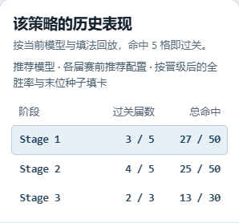
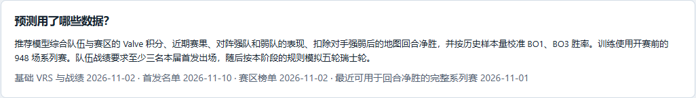

# CS2 新加坡 Major 2026 预测 · Singapore Major Pick’Em

[](https://cs2-pickem-matchlab.dustydell9.chatgpt.site/#picks)

## Stage 1 怎么填？

**交一张卡，建议选 A。** 两张卡均于 11 月 21 日赛前封存。11 月 24 日开赛，五轮结束后按实际战绩计分。把同一列的十支队伍填进游戏，命中至少五格即可过关。[打开 Fango’s Lab 预测](https://cs2-pickem-matchlab.dustydell9.chatgpt.site/#picks)

| 游戏中的位置 | A · 正式推荐 | B · 考虑同阵容往届 Major 表现 |
| --- | --- | --- |
| **3–0** · 两支全胜 | **Ninjas in Pyjamas、Eternal Fire** | **FaZe、Eternal Fire** |
| **普通晋级** · 六支 3–1 或 3–2 | PARIVISION、HEROIC、FaZe、Liquid、100 Thieves、Imperial | Ninjas in Pyjamas、PARIVISION、HEROIC、100 Thieves、M80、Imperial |
| **0–3** · 两支全败 | **Chinggis Warriors、Lynn Vision** | **Chinggis Warriors、Lynn Vision** |

**拿不准选哪张？** 分歧集中在 FaZe 和 NiP 谁能全胜，以及最后一个普通晋级位给 Liquid 还是 M80。B 把同核心在往届 Major 各阶段的表现纳入判断。它在五届旧首阶段回放中多过了一届，收益集中在上海。额外检验的 EPL S23 第一阶段两种方案都只中 3 格，因此本站继续以 A 作为正式提交建议。[A 卡原件](forecast_archive/singapore-stage1-seed-conditional-2026-11-21.json) · [B 卡原件](forecast_archive/singapore-stage1-earlier-stages-2026-11-21.json) · [跨阶段实验](stage_transfer/README.md) · [EPL 留出检验](stage1_holdout/README.md)

## 该策略的历史表现




| 已完赛的瑞士阶段 | A 卡方法过关届数 | A 卡方法命中格数 |
| --- | ---: | ---: |
| Stage 1 · 最近五届 | 3/5 | 27/50 |
| Stage 2 · 最近五届 | 4/5 | 25/50 |
| Stage 3 · 奥斯汀、布达佩斯、科隆（分组填卡） | 2/3 | 13/30 |

B 卡方法在相同五届 Stage 1 中过关 **4/5**，命中 **28/50**。表中计数来自真实赛果，每届按十个位置计分，达到五格记一次过关。随机种子用于检查同一输入换一批模拟会不会改卡。新加坡两张封存卡单独等待评分。[历史逐阶段成绩](https://cs2-pickem-matchlab.dustydell9.chatgpt.site/#verify) · [评分口径](stage_goals/PROSPECTIVE.md)

## 预测用了哪些数据？




1. **认准上场的五个人。** A 卡采用 11 月 2 日的 Valve 区域排名与近期比赛快照，首发依据截至 11 月 10 日。只有与目标队直接重合至少三名首发的历史比赛才继承。EF 的 37 场有效历史中，36 场由本届五人打出，1 场保留四人。[EF 与全部 16 队首发依据](lineup_pairs/RESULTS.md)
2. **先估每场，再排整卡。** 正式模型综合双方积分差、近期状态、面对强弱队的表现和地图小分，对 BO1 与 BO3 分别校准。瑞士轮按实际赛制配对，模拟十个位置联合命中至少五格的机会。B 卡进一步使用以往已结束 Major 的同核心表现，来源覆盖 13 个阶段、429 场系列赛。[胜率与填卡方法](method_eval/README.md) · [B 卡来源与截止规则](stage_transfer/PROTOCOL.md)
3. **用 Elo 与地图 ML 交叉检查。** 180 天阵容 Elo 和一年期地图 ML 提供独立的实力估计。研究中分别比较单场误差和整卡实分。五届 Stage 1 固定填法下，Elo 过 1/5、地图 ML 过 2/5，可用来定位模型分歧。[Elo、ML 与整卡实验](f1bre_models/RESULTS.md)

## 网页能做什么？

- **交作业前**打开本阶段预测，看每个位置、队伍首发和推荐理由。[预测与阵容](https://cs2-pickem-matchlab.dustydell9.chatgpt.site/#picks/rosters)
- **想换一支队**就打开从左到右的瑞士轮对阵图，手动选一场胜者，查看后续可能遇到的对手。[手动推演](https://cs2-pickem-matchlab.dustydell9.chatgpt.site/#bracket)
- **想核对模型**可单选推荐模型、决策树、阵容 Elo、地图 ML、Elo ＋ ML 或四模型等权，在右侧查看对应配置的各阶段历史命中，并可查看逐届成绩。[模型与历史表现](https://cs2-pickem-matchlab.dustydell9.chatgpt.site/#picks)

目前开放 Stage 1。Stage 2、3 入口会在晋级队伍和首发确定、对应数据发布后开放。Elo ＋ ML 对每场 BO1、BO3 等权平均两套赛前胜率，四模型等权另将推荐模型、决策树、阵容 Elo 与地图 ML 各计 25%。六个选项使用同一套瑞士轮对阵规则。预测图取自 Sites 桌面版，展示参赛队标。

四模型等权在 Stage 2 中 27/50 格、过 4/5 届；Stage 3 中 10/30 格、过 0/3 届。完整实验区分胜率与填法，并列出 BO1、BO3 误差。[四模型对照](f1bre_models/four_way/RESULTS.md)

## 最近验证了什么？

- 新加坡首阶段的首轮对手「双架」经三组配对采样，整张过关率均下降。[方法、逐种子结果和历史回放](external_forecasts/CANYUN.md)

- 比较科隆赛前已有 Git 签名时间的外部预测，按本站规则确实中 5/10。单独移植其中的晋级战绩加分，科隆快速回放从 2 格升到 4 格，奥斯汀两组从 5 格降到 4 格。另一种只交换分歧队伍位置的方法，也没有增加三届总过关数。[上阶段战绩实验](f1bre_models/entry_record/RESULTS.md) · [分歧换位](f1bre_models/disputed_swap/RESULTS.md) · [外部科隆与新加坡预测](external_forecasts/README.md)
- 单换 2–0 对局的 BO3 胜率，地图 ML 在科隆多中两格，三组种子的总过关数都持平。加入同核心往届全胜表现后，主种子在奥斯汀从 5 格掉到 3 格。两项均保留原默认。[全胜对局](f1bre_models/sweep_decider/RESULTS.md) · [同核心全胜经验](f1bre_models/core_sweep/RESULTS.md)
- 新加坡 Stage 1 已在开赛前封存 Pley 的十格预测。Imperial 在本站是普通晋级，在 Pley 是 0–3，待完赛后按同一规则评分。[逐队分歧与计分](external_forecasts/README.md)
- 布加勒斯特的 33 场 BO3 中，正式推荐和地图 ML 交出了相同的十格预测，都中 3/10。单换两个 0–3 位，事后最多也只能中 4 格。三届 Major 回放同样没有支持按榜后战绩改选全败队。[布加勒斯特逐场复盘](f1bre_models/format_split/bucharest26/RESULTS.md) · [全败位对照](f1bre_models/late_tail/RESULTS.md)
- 卡托维兹的 33 场 BO3 中，正式推荐和地图 ML 都猜对六支晋级队。ML 把 Vitality 和 Falcons 放对了位置，整卡从 3/10 提至 5/10，但它对两场冷门的胜者都只给了 0.725% 胜率。[逐场胜率和整卡对照](f1bre_models/format_split/epl24/RESULTS.md)
- 调整地图 ML 的胜率校准后，三届 Stage 3 单场误差略降。换 30 组种子复核，能过两届的种子从 20 组降到 8 组，该调整已结束试验。[校准前后对照](f1bre_models/smooth_calibration/RESULTS.md)
- Stage 3 分组填卡在 Major 回放过 2/3 届，五场外部赛事的过关数持平或减少，现已设为推荐模型的 Stage 3 默认填法，可手动关闭。[逐场复核](final_card/group_audit/RESULTS.md)
- 新加坡 16 支队伍都按赛前证据归类。六种已检验对位的留出成绩均未支持胜率修正，默认幅度为 0 个百分点。[战队分类与克制幅度](styles_model/DEFAULTS.md)


- 阿斯塔纳的 33 场 BO3 中，地图 ML 降低了单场预测误差，三套主卡均中 6/10。[全 BO3 留出检验](f1bre_models/format_split/astana/RESULTS.md)
- 两负淘汰局里，用选手往届的 ADR 变化修正预测，误差从 9.59 升至 11.09。该项留作研究。[选手高压表现回测](pressure/RESULTS.md)

## 本地运行与研究复算

[下载离线网页版](https://github.com/FanQAQ/cs2-singapore-major-2026-pickem-predictor/releases/latest/download/fangos-lab-offline.zip)，解压后打开 `index.html`。从源码运行时，用浏览器打开 `dist/index.html`，或运行下面的命令并访问 `http://127.0.0.1:8000`。

```sh
python -m http.server 8000 --bind 127.0.0.1 --directory dist
```

日常研究直接读取冻结胜率，默认用三个配对种子，各抽 2,000 条路径选卡、另抽 4,000 条核分。可以指定赛事，也可以省略赛事 ID 一次比较三届 Stage 3。完整历史归档通过 `--check` 复核。[快速模式与实测速率](f1bre_models/SCREEN.md)

```sh
node f1bre_models/evaluate.cjs cologne-2026-3
node f1bre_models/check-screen.cjs
node engine/validate.cjs
```

参考项目包括 F1bre 的 Elo 与机器学习预测器，以及按赛制配置和输出推荐卡的 Major Pick’ems Simulator。各自的训练数据、截止日和评分协议请见对应仓库。[F1bre Elo](https://github.com/holygodly/CS2-Major-ELO-PickEm-Predictor) · [F1bre ML](https://github.com/holygodly/CS2-Major-ML-PickEm-Predictor) · [Major Pick’ems Simulator](https://github.com/ndunnett/major-pickems-sim)

原创代码与技术文档采用 MIT 许可。离线网页使用原创队名缩写图标，各数据和素材按来源单独署名。网站发布版本、离线下载和研究明细另有记录。[MIT License](LICENSE) · [第三方资料与许可](THIRD_PARTY.md) · [完整项目说明](PROJECT-NOTES.md) · [Sites v34 快照](https://github.com/FanQAQ/cs2-singapore-major-2026-pickem-predictor/tree/sites-v34)
