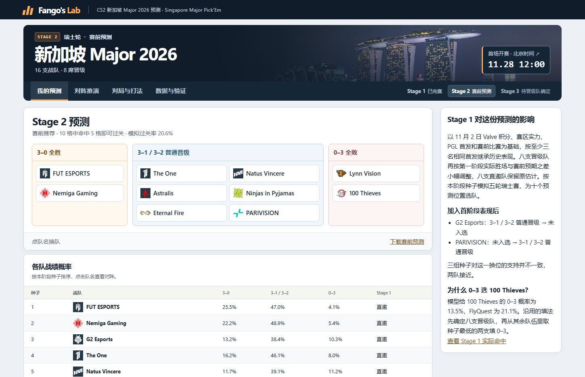
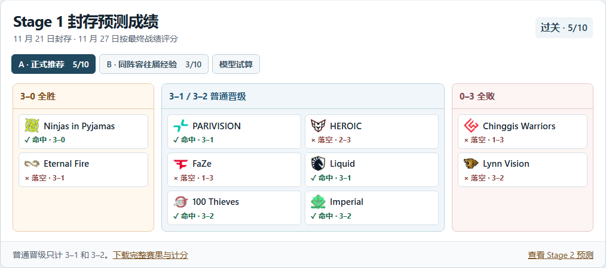
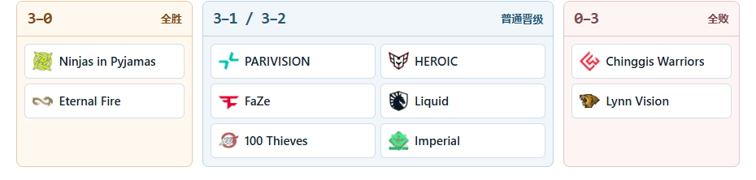
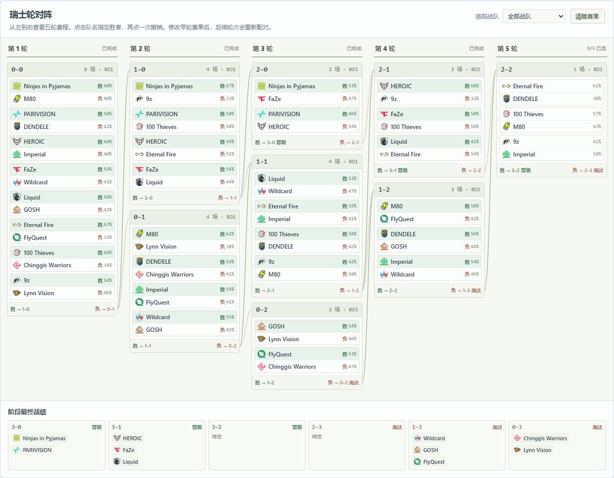

# CS2 新加坡 Major 2026 预测 · Singapore Major Pick’Em

## 新加坡 Stage 2 赛前预测

**11 月 27 日 23:07（北京时间）封存。** 首轮于 11 月 28 日 12:00 开打。网页打开即显示第二阶段的十格选择和全部 16 队的战绩概率。[打开 Stage 2](https://cs2-pickem-matchlab.dustydell9.chatgpt.site/?stage=2#picks) · [下载赛前预测](dist/forecasts/singapore-stage2-2026-11-27.json)

| 3–0 全胜 | 3–1 或 3–2 普通晋级 | 0–3 全败 |
| --- | --- | --- |
| FUT、Nemiga | The One（1win）、NAVI、Astralis、NiP、Eternal Fire、PARIVISION | Lynn Vision、100 Thieves |

**第一阶段带来了什么变化？** 以 Valve 11 月 2 日积分、参赛首发和赛前比赛为起点，比较八支晋级队实际赢了几场、按对手强度原本预计能赢几场。FlyQuest 原本预期拿 1.10 胜，实际三战全胜，对 FUT 的首轮胜率从 26.6% 升至 33.6%。十格里只变了一队，PARIVISION 取代 G2 填普通晋级。三组配对模拟中，这一换位对过关率的影响约为 −0.01 至 +0.47 个百分点，两队接近。[数据与计算方法](singapore_stage2/README.md)

100 Thieves 的 0–3 是风险位。它拿了三胜，按首阶段面对的对手原本预计拿 2.89 胜。当前填法在八个预测晋级队以外取种子最低的两队填全败，所以选中第 16 号种子 100 Thieves。模型给它的 0–3 概率是 13.5%，低于 FlyQuest 的 21.1%。整张预测在主种子的独立验证模拟中过关率为 **20.65%**。[查看 16 队概率及对照预测](singapore_stage2/forecast.json)

## Stage 1 封存预测与实际成绩

**成绩单 · A 命中 5/10，B 命中 3/10。** A 命中 NiP 的 3–0，以及 PARIVISION、Liquid、100 Thieves、Imperial 的普通晋级。B 命中其中 PARIVISION、100 Thieves、Imperial 三个普通晋级位。实际两支 0–3 是 GOSH（BC.Game）和 DENDELE（原 Sharks 阵容）。最后一场 100 Thieves 以 2–1 击败 M80。网页可切换 A/B，查看每个位置选了谁、实际几胜几负。[查看逐格评分](https://cs2-pickem-matchlab.dustydell9.chatgpt.site/?stage=1#picks) · [PGL 完整赛果](https://news.pglesports.com/api/groupStageEndpoint?stage=1)

**方案 A · 11 月 21 日正式预测原图**　NiP 和 Eternal Fire 填 3–0，实际分别为 3–0 和 3–1。

**方案 B · 11 月 21 日备选预测原图**　加入同阵容的往届 Major 表现后，FaZe 与 NiP 对调位置，普通晋级的 Liquid 换成 M80。

新加坡 Stage 1 于 11 月 24–27 日进行。十格命中五格即可过关，普通晋级的六个位置只计 3–1 和 3–2。[下载首阶段逐格评分与比赛记录](dist/forecasts/singapore-stage1-results-2026-11-27.json)

**选队依据。** A 用 11 月 2 日的 Valve 排名、PGL 报名名单和赛前比赛记录估算 BO1、BO3 胜率。模型考虑近期胜负、对手强弱和地图净胜回合，再模拟五轮瑞士赛，为整张预测分配十个位置。历史战绩要求至少三名首发相同。例如，EF 纳入的 37 场比赛里，36 场由本届五人出战，另 1 场保留四人。[阵容核对](lineup_pairs/RESULTS.md) · [模型方法](method_eval/README.md) · [A 封存原件](forecast_archive/singapore-stage1-seed-conditional-2026-11-21.json) · [B 封存原件](forecast_archive/singapore-stage1-earlier-stages-2026-11-21.json)

## 对阵推演

**如果 NiP 首轮击败 M80，后面可能遇到谁？** 图中前四轮的胜者都是手动指定的。沿这条路径，NiP 第二轮遇到 9z，第三轮遇到 FaZe；改点另一支首轮胜队，就能看到后续配对怎样变化。

首轮采用赛事公布的种子和对阵，后续按该届瑞士轮规则重排。队名旁的百分比是两队在这场相遇时的胜率。用它可以检查一支队伍要走到 3–0，沿途需要赢下哪些对局。[打开对阵推演](https://cs2-pickem-matchlab.dustydell9.chatgpt.site/?stage=1#bracket) · [赛制与历史阶段来源](multi_stage/INPUTS.md)

## 对局与打法

**EF 的优势有多少来自打法？** 推荐模型给 EF 对 FlyQuest 的首轮 BO1 胜率为 **67.2%**。赛前资料将 EF 归为「主动接战」、FlyQuest 归为「临场读局」。这组打法对位只有 1 场训练、1 场留出，默认给 EF 的胜率修正为 **0 个百分点**。看比赛时可以留意 EF 能否抢下第一枪、FlyQuest 能否及时补枪。

16 队的标签中，10 队依据近期整队战术资料，5 队依据同核心比赛录像，另 1 队依据近期地图记分板。网页可逐队查看证据日期、阵容重合人数和来源。六种对位都未在留出比赛中稳定改善胜率估计，默认修正均为零。[打开对局与打法](https://cs2-pickem-matchlab.dustydell9.chatgpt.site/?stage=1#duel) · [16 队分类与对位检验](styles_model/DEFAULTS.md)

## 以往赛事中的成绩

下表按**当前推荐模型的默认配置**重放已完赛 Major。每届只用该阶段开赛前可得的资料填十格，再用真实赛果逐格计分。

| 阶段 | 过关届数（至少 5/10） | 总命中 |
| --- | ---: | ---: |
| Stage 1 · 哥本哈根、上海、奥斯汀、布达佩斯、科隆 | **3/5** | **27/50** |
| Stage 2 · 同五届 | **4/5** | **25/50** |
| Stage 3 · 奥斯汀、布达佩斯、科隆 | **2/3** | **13/30** |

**首阶段当时为什么推荐 A？** B 在五届 Stage 1 回放中过了 4/5 届、命中 28/50 格。多过的一届是上海，A 中 4 格、B 中 6 格，科隆两份都中 4 格。在额外留出的 EPL S23 首阶段，两份都只中 3 格。上表五届已参与开发，新加坡作为独立赛前预测单列，此次 A 中 5 格、B 中 3 格。Stage 2 行的 4/5 是既有策略在历史赛事的成绩，补入各届已结束的 Stage 1 逐场表现后，三组种子的五届回放仍为 4/5 届、25/50 格。新加坡本届的实际分数待 Stage 2 完赛后计算。[同届数据迁移复核](singapore_stage2/historical.json)[逐届对照](stage_transfer/README.md) · [EPL 留出检验](stage1_holdout/README.md) · [Stage 3 分组填法复核](final_card/group_audit/RESULTS.md)

离线使用可下载网页版，解压后打开 `index.html`；源码仓库的入口是 `dist/index.html`。原创代码与技术文档使用 MIT 许可，队标及第三方数据的来源另列。[下载离线网页版](https://github.com/FanQAQ/cs2-singapore-major-2026-pickem-predictor/releases/latest/download/fangos-lab-offline.zip) · [项目与复算说明](PROJECT-NOTES.md) · [MIT 许可](LICENSE) · [第三方署名](THIRD_PARTY.md)
