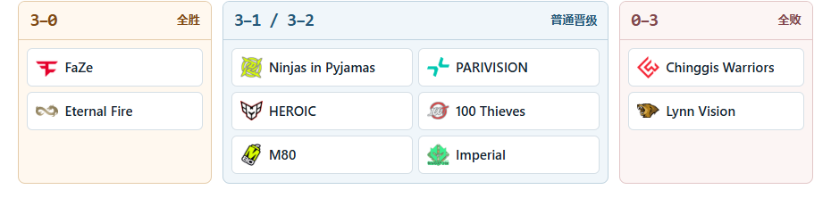
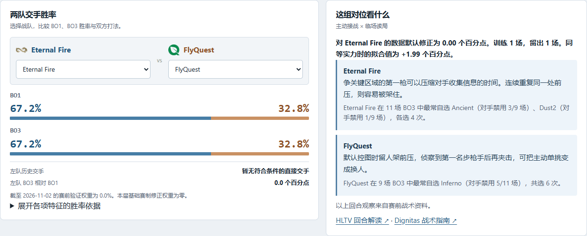

# CS2 新加坡 Major 2026 预测 · Singapore Major Pick’Em

## 我的预测

**方案 A · 正式推荐**　只交一份时建议选 A。NiP 和 Eternal Fire 填 3–0。

**方案 B · 加入同阵容的往届 Major 表现**　FaZe 与 NiP 对调位置，普通晋级的 Liquid 换成 M80。

新加坡 Stage 1 于 11 月 24 日开赛，A、B 两份预测均在 11 月 21 日封存。十格命中五格即可过关；普通晋级的六个位置只计 3–1 和 3–2。网页在预测下方列出全部 16 队的战绩概率，方便换队前比较。[打开我的预测](https://cs2-pickem-matchlab.dustydell9.chatgpt.site/#picks)

**选队依据。** A 用 11 月 2 日的 Valve 排名、PGL 报名名单和赛前比赛记录估算 BO1、BO3 胜率。模型考虑近期胜负、对手强弱和地图净胜回合，再模拟五轮瑞士赛，为整张预测分配十个位置。历史战绩要求至少三名首发相同。例如，EF 纳入的 37 场比赛里，36 场由本届五人出战，另 1 场保留四人。[阵容核对](lineup_pairs/RESULTS.md) · [模型方法](method_eval/README.md) · [A 封存原件](forecast_archive/singapore-stage1-seed-conditional-2026-11-21.json) · [B 封存原件](forecast_archive/singapore-stage1-earlier-stages-2026-11-21.json)

## 对阵推演

**如果 NiP 首轮击败 M80，后面可能遇到谁？** 图中前四轮的胜者都是手动指定的。沿这条路径，NiP 第二轮遇到 9z，第三轮遇到 FaZe；改点另一支首轮胜队，就能看到后续配对怎样变化。

首轮采用赛事公布的种子和对阵，后续按该届瑞士轮规则重排。队名旁的百分比是两队在这场相遇时的胜率。用它可以检查一支队伍要走到 3–0，沿途需要赢下哪些对局。[打开对阵推演](https://cs2-pickem-matchlab.dustydell9.chatgpt.site/#bracket) · [赛制与历史阶段来源](multi_stage/INPUTS.md)

## 对局与打法

**EF 的优势有多少来自打法？** 推荐模型给 EF 对 FlyQuest 的首轮 BO1 胜率为 **67.2%**。赛前资料将 EF 归为「主动接战」、FlyQuest 归为「临场读局」。这组打法对位只有 1 场训练、1 场留出，默认给 EF 的胜率修正为 **0 个百分点**。看比赛时可以留意 EF 能否抢下第一枪、FlyQuest 能否及时补枪。

16 队的标签中，10 队依据近期整队战术资料，5 队依据同核心比赛录像，另 1 队依据近期地图记分板。网页可逐队查看证据日期、阵容重合人数和来源。六种对位都未在留出比赛中稳定改善胜率估计，默认修正均为零。[打开对局与打法](https://cs2-pickem-matchlab.dustydell9.chatgpt.site/#duel) · [16 队分类与对位检验](styles_model/DEFAULTS.md)

## 以往赛事中的成绩

下表按**当前推荐模型的默认配置**重放已完赛 Major。每届只用该阶段开赛前可得的资料填十格，再用真实赛果逐格计分。

| 阶段 | 过关届数（至少 5/10） | 总命中 |
| --- | ---: | ---: |
| Stage 1 · 哥本哈根、上海、奥斯汀、布达佩斯、科隆 | **3/5** | **27/50** |
| Stage 2 · 同五届 | **4/5** | **25/50** |
| Stage 3 · 奥斯汀、布达佩斯、科隆 | **2/3** | **13/30** |

**为什么首阶段仍推荐 A？** B 在五届 Stage 1 回放中过了 4/5 届、命中 28/50 格。多过的一届是上海，A 中 4 格、B 中 6 格；科隆两份都中 4 格。在额外留出的 EPL S23 首阶段，两份都只中 3 格。这五届 Major 已参与策略开发，新加坡两份封存预测将在完赛后单独评分。[逐届对照](stage_transfer/README.md) · [EPL 留出检验](stage1_holdout/README.md) · [Stage 3 分组填法复核](final_card/group_audit/RESULTS.md)

离线使用可下载网页版，解压后打开 `index.html`；源码仓库的入口是 `dist/index.html`。原创代码与技术文档使用 MIT 许可，队标及第三方数据的来源另列。[下载离线网页版](https://github.com/FanQAQ/cs2-singapore-major-2026-pickem-predictor/releases/latest/download/fangos-lab-offline.zip) · [项目与复算说明](PROJECT-NOTES.md) · [MIT 许可](LICENSE) · [第三方署名](THIRD_PARTY.md)
